# Personal Expense Tracker

**Course:** MCA Semester I — SEC Assignment  
**Repository:** [dhruvnailwal/personal-expense-tracker](https://github.com/dhruvnailwal/personal-expense-tracker)

*A console-based C++ application for recording, organizing, and analysing personal expenses.*

## Description

**Personal Expense Tracker** is a menu-driven C++ program that helps a user maintain
a record of daily expenses. Each expense stores an ID, name, category, amount, and
date. The application supports adding, updating, searching, deleting, sorting, and
displaying expenses, along with monthly and category-wise reports. It also provides
basic income and budget tracking with an over-budget warning.

The project is organized into separate header and source files and was developed
collaboratively using Git, feature branches, pull requests, and code reviews.

## Objectives

- Record personal expenses with valid dates and amounts.
- Organize expenses by category and month.
- Allow users to search, update, delete, and sort expense records.
- Calculate total spending and remaining budget.
- Provide clear monthly and category-wise summaries.
- Demonstrate a complete Git/GitHub collaborative workflow.

## Team Members and Contributions

| Member | Contributions |
|---|---|
| Dhruv Nailwal | Repository setup, `.gitignore`, core tracker logic, delete expense, income/budget tracking, documentation |
| Vanshika Goyal | Case-insensitive search, expense sorting, menu and input handling, testing, documentation |

## Features

| No. | Feature | Description | Developed by |
|---|---|---|---|
| 1 | Add expense | Add an expense with ID, name, category, amount, and date | Both |
| 2 | Display expenses | Display all saved expense records | Both |
| 3 | Update expense | Update an existing expense by ID | Both |
| 4 | Calculate total | Calculate the total value of all expenses | Both |
| 5 | Search expense | Search by name without case sensitivity | Vanshika Goyal |
| 6 | Monthly report | Show expenses and total for a selected month and year | Both |
| 7 | Category-wise report | Summarize expense count and total by category | Both |
| 8 | Sort expenses | Sort by amount or date, ascending or descending | Vanshika Goyal |
| 9 | Delete expense | Delete an expense by ID | Dhruv Nailwal |
| 10 | Income and budget | Set income and monthly budget values | Dhruv Nailwal |
| 11 | Budget status | Show total spent, remaining budget, and a warning when over budget | Dhruv Nailwal |
| 12 | Input validation | Reject invalid numbers, negative amounts, and invalid dates | Both |

## Technologies Used

- **Language:** C++11
- **Standard library:** `<iostream>`, `<vector>`, `<string>`, `<map>`, `<algorithm>`, `<cctype>`, `<limits>`
- **Compiler:** `g++`
- **Version control:** Git and GitHub
- **Documentation:** Markdown

## Project Structure

```text
SEC ASSIGNMENT/
├── include/
│   ├── Date.h
│   ├── Expense.h
│   └── PersonalExpenseTracker.h
├── src/
│   ├── Date.cpp
│   ├── PersonalExpenseTracker.cpp
│   └── main.cpp
├── docs/
│   └── screenshots/
│       └── Screenshot *.png
├── .gitignore
├── version.txt
└── README.md
```

| File | Purpose |
|---|---|
| `include/Date.h` | Declares the `Date` structure and date validation methods |
| `include/Expense.h` | Declares the `Expense` structure |
| `include/PersonalExpenseTracker.h` | Declares the tracker class and public operations |
| `src/Date.cpp` | Implements date validation and display |
| `src/PersonalExpenseTracker.cpp` | Implements expense and report logic |
| `src/main.cpp` | Menu, input handling, and program entry point |

## Installation and Execution

### Prerequisites

- Windows, Linux, or macOS
- A C++11-compatible compiler
- Git, if you want to clone the repository

Check that `g++` is available:

```bash
g++ --version
```

### Clone the repository

```bash
git clone https://github.com/dhruvnailwal/personal-expense-tracker.git
cd personal-expense-tracker
```

### Build

From the project root:

```powershell
g++ -std=c++11 -Wall -Wextra -Iinclude src/Date.cpp src/PersonalExpenseTracker.cpp src/main.cpp -o expense_tracker.exe
```

### Run

On Windows PowerShell:

```powershell
.\expense_tracker.exe
```

On Linux or macOS:

```bash
./expense_tracker
```

## Usage

1. Select **Add Expense** and enter the expense ID, name, category, amount, and date.
2. Use **Display All Expenses** to view all records.
3. Use **Update Expense** or **Delete Expense** with an existing expense ID.
4. Use **Search Expense** to find an expense by name.
5. Use **Monthly Report** or **Display Category-wise Expenses** for summaries.
6. Use **Sort Expenses** to order records by amount or date.
7. Use **Set Income / Budget** and **View Budget Status** to monitor spending.
8. Select **Exit** to close the application.

> Dates must be entered in `DD MM YYYY` format. Expense IDs must be unique.

## Sample Output

```text
===== PERSONAL EXPENSE TRACKER =====
1. Add Expense
2. Display All Expenses
3. Update Expense
4. Calculate Total Expense
5. Search Expense
6. Monthly Report
7. Display Category-wise Expenses
8. Sort Expenses
9. Delete Expense
10. Set Income / Budget
11. View Budget Status
12. Exit

Enter your choice: 10
Enter Income: 50000
Income Updated Successfully

Enter Budget: 15000
Budget Updated Successfully

Enter your choice: 11

----- Budget Status -----
Income: 50000
Budget: 15000
Total Spent: 1250.5
Remaining Budget: 13749.5
You are within your budget.
```

```text
Enter your choice: 5
Enter Expense Name to Search: lunch

Expense ID: 101
Name: Lunch
Category: Food
Amount: 250
Date: 14/11/2026
```

## Screenshots

The screenshots below document the project development, Git/GitHub workflow,
merge-conflict resolution, and program output.

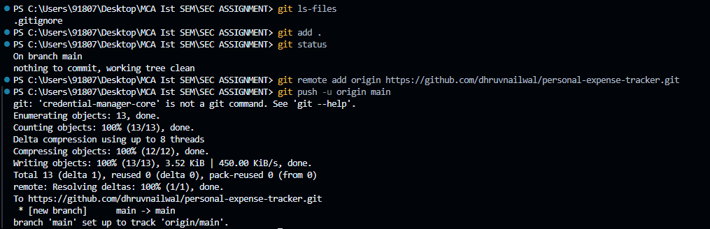

*Project screenshot 1*

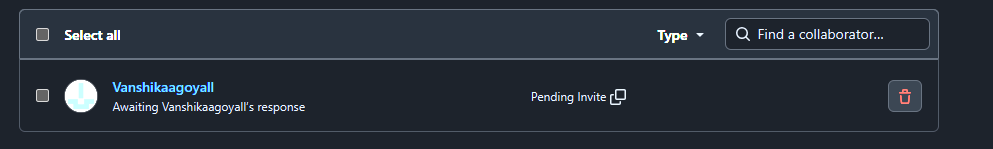

*Project screenshot 2*

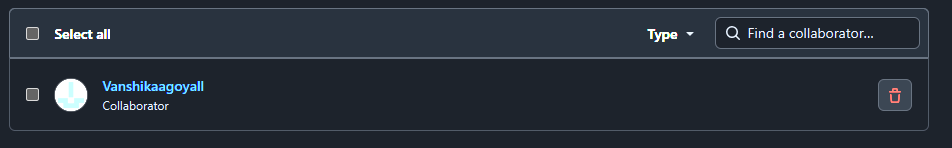

*Project screenshot 3*

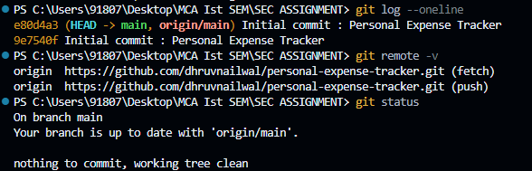

*Project screenshot 4*

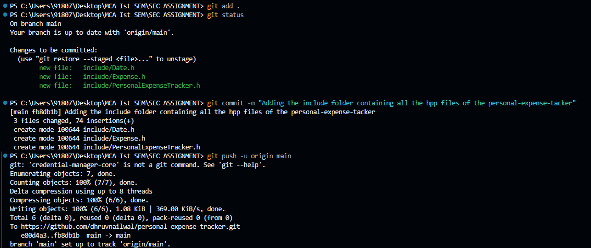

*Project screenshot 5*

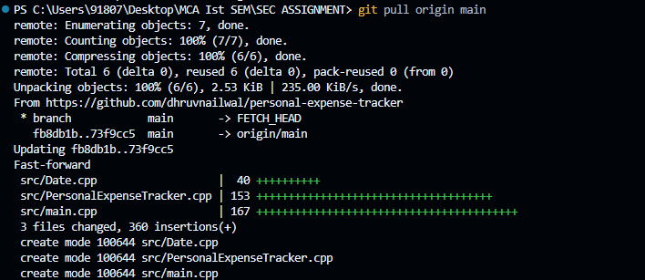

*Project screenshot 6*

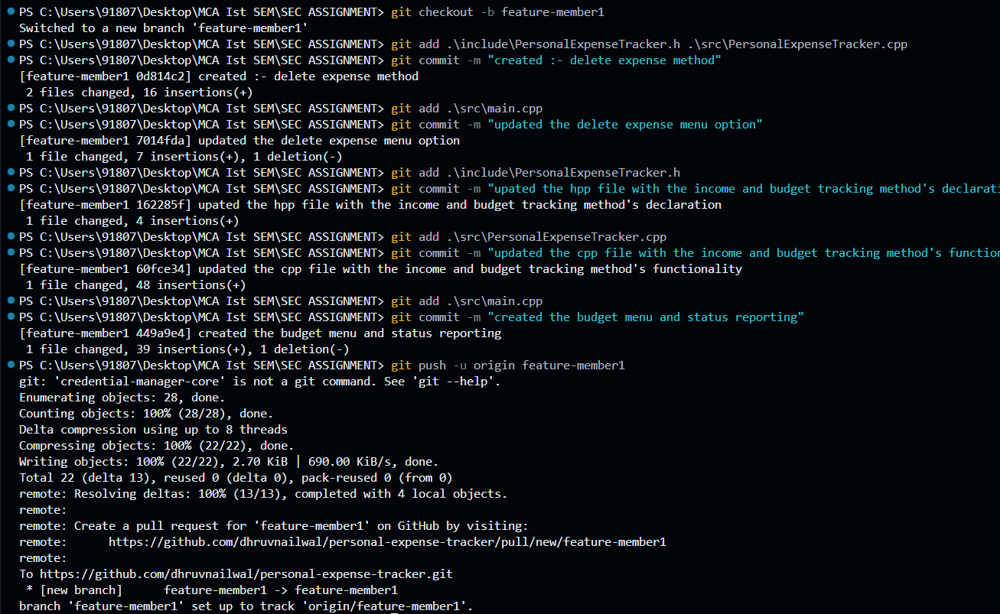

*Project screenshot 7*

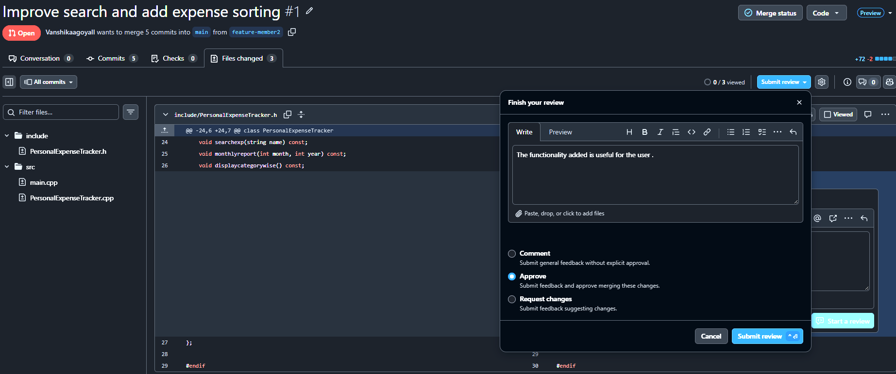

*Project screenshot 8*

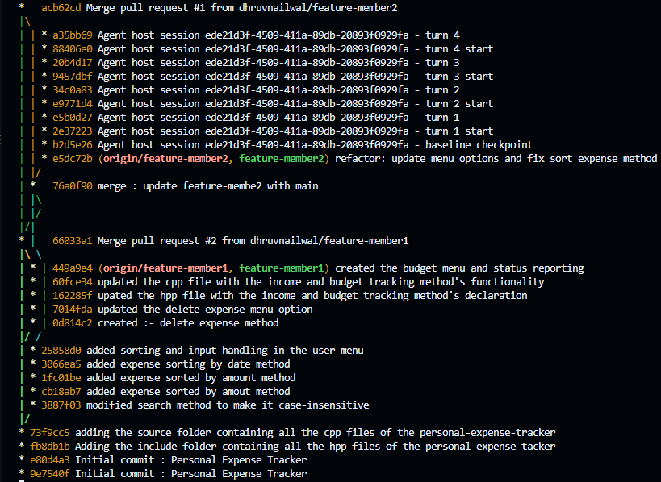

*Project screenshot 9*

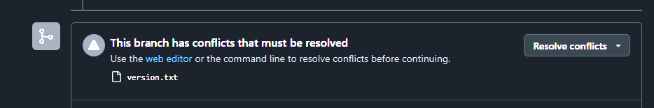

*Project screenshot 10*

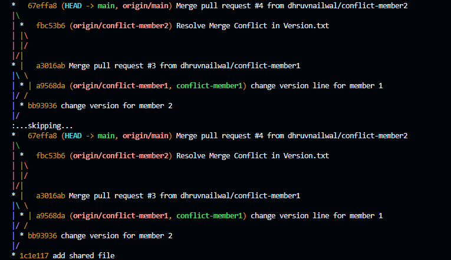

*Project screenshot 11*

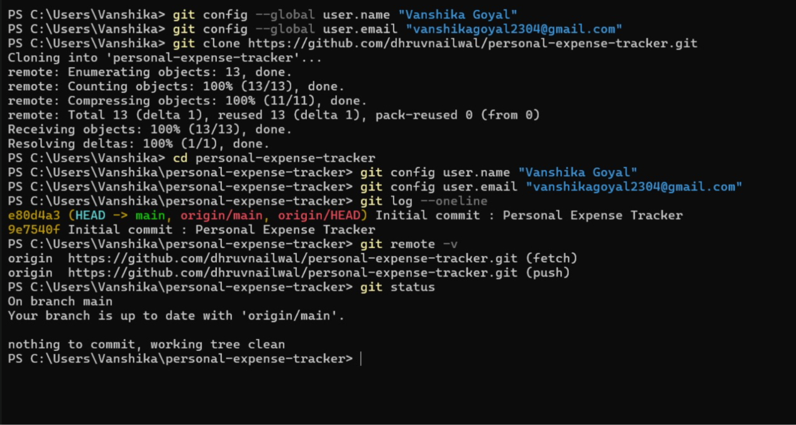

*Project screenshot 12*

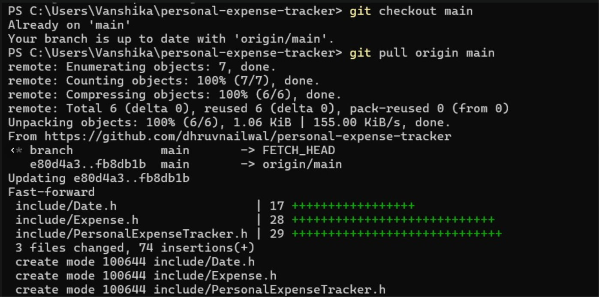

*Project screenshot 13*

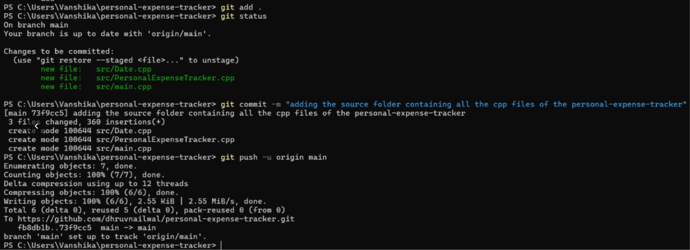

*Project screenshot 14*

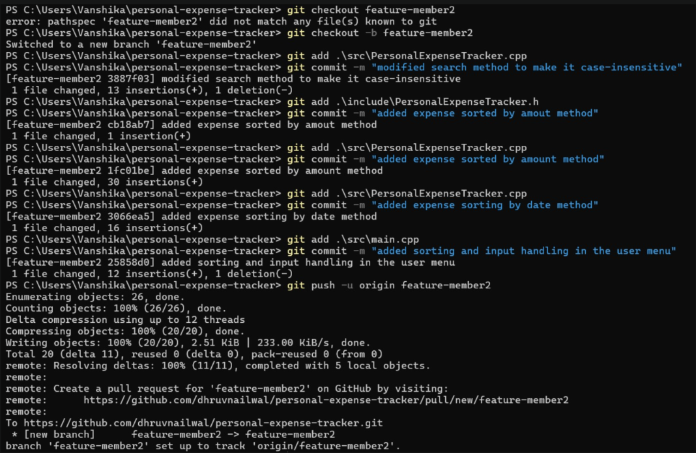

*Project screenshot 15*

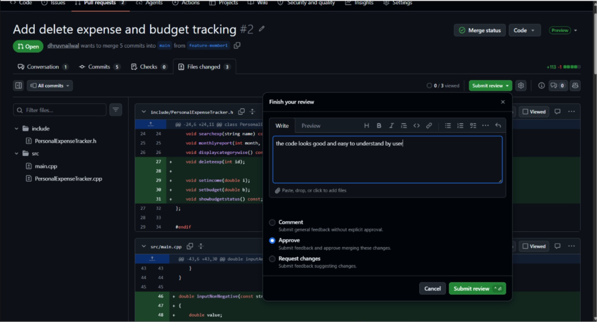

*Project screenshot 16*

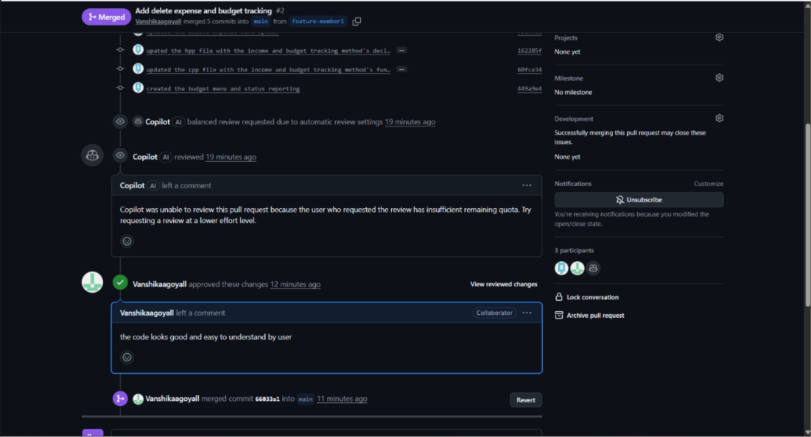

*Project screenshot 17*

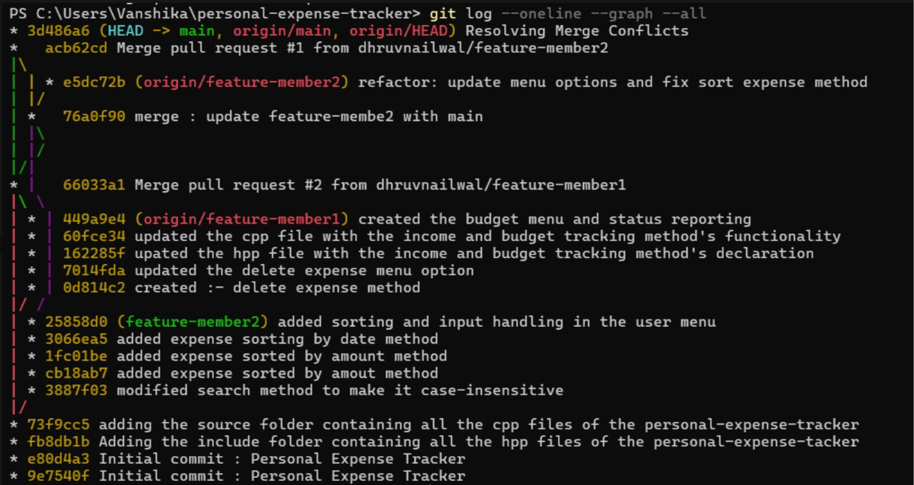

*Project screenshot 18*

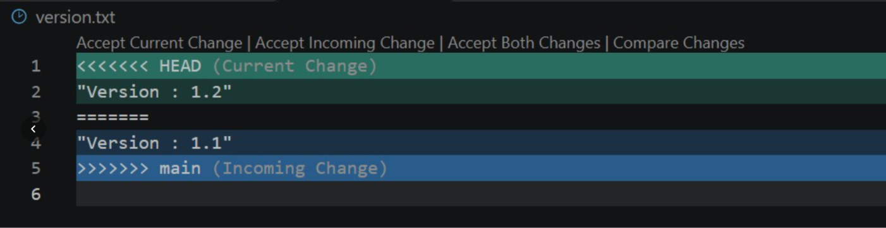

*Project screenshot 19*

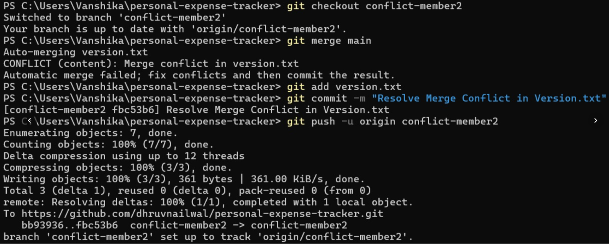

*Project screenshot 20*

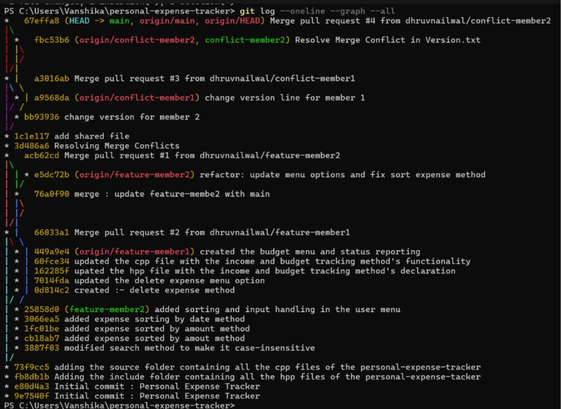

*Project screenshot 21*

## Git Workflow

- `main` contains the stable, merged version of the project.
- Dhruv Nailwal implemented features on `feature-member1`.
- Vanshika Goyal implemented features on `feature-member2`.
- A separate conflict demonstration used `conflict-member1` and `conflict-member2`.
- Each feature branch was pushed to GitHub and merged through a pull request.
- Each pull request was reviewed by the other member before merging.

View the commit history with:

```bash
git log --oneline --graph --all
```

## Merge Conflict Resolution

Dhruv Nailwal and Vanshika Goyal changed the same line in `version.txt`. Git
reported a merge conflict when the second branch was merged. The conflict markers
were removed, both changes were combined, and the corrected file was committed as
the resolution. The final `version.txt` contains:

```text
Version: 1.2 (Member 1 + Member 2 -- conflict resolved)
```

## Future Enhancements

- Persist expenses to a file or database.
- Add expense editing through the search results.
- Export reports to CSV or PDF.
- Add a graphical or web-based interface.
- Add automated unit tests.

## Acknowledgement

This project was developed as part of the **MCA Semester I SEC assignment** to
demonstrate C++ programming and collaborative Git/GitHub development practices.
